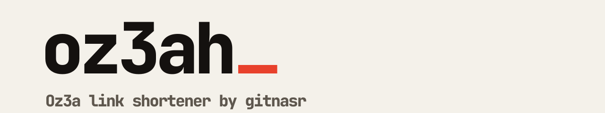

<picture>
  <source media="(prefers-color-scheme: dark)" srcset="banner-dark.svg">
  
</picture>

Oz3a is a link shortener. Paste a long URL, get a short one, and see who opened it.

[oz3a.top](https://oz3a.top) · [API](https://github.com/oz3ah/api)

## Repositories

| Repository | What it is |
| :--- | :--- |
| [`api`](https://github.com/oz3ah/api) | ASP.NET Core backend: links, redirects, analytics, subscriptions |
| `frontend` | Next.js web app |
| `extension` | Browser extension that shortens the current page |
